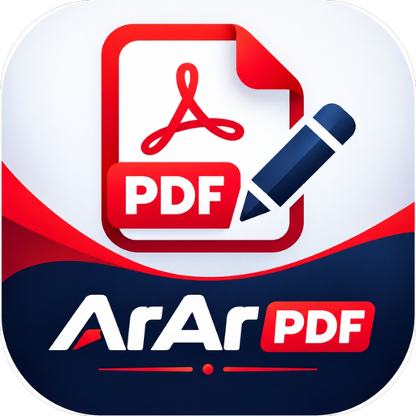

<div align="center">
  
  <h1>ArAr PDF</h1>
  <p><strong>Mobile PDF Editor & Document Manager All-in-One — 100% Offline, Cepat & Aman</strong></p>

  <p>
    <a href="https://github.com/gudangjoker/ArAr-PDF/releases/latest">
      
    </a>
    
    
    
  </p>
</div>

---

## 📖 Tentang ArAr PDF

**ArAr PDF** adalah aplikasi Android multifungsi untuk membaca, mengelola, menggabungkan, mengonversi, dan mengompresi dokumen PDF secara lokal di perangkat tanpa membutuhkan koneksi internet. Seluruh data tetap berada di smartphone Anda.

---

## ✨ Fitur Unggulan

* 📄 **Kelola Halaman (Page Manager)**:
  * Atur ulang urutan halaman (naik/turun).
  * Hapus halaman tertentu yang tidak diperlukan.
  * Sisipkan halaman kosong (blank page A4) atau sisipkan foto/gambar baru.
  * Simpan hasil modifikasi sebagai dokumen PDF baru.

* 📑 **Penggabungan PDF (Merge)**:
  * Gabungkan 2 atau lebih dokumen PDF menjadi satu.
  * Urutkan file sumber sesuai kebutuhan.
  * Dilengkapi validasi dan mekanisme fallback otomatis untuk keamanan berkas.

* 🔄 **Konversi Berkas ke PDF**:
  * **Foto ke PDF**: Ubah gambar JPG, PNG, atau WEBP menjadi PDF halaman A4 proporsional.
  * **Word (.docx) ke PDF**: Konversi dokumen Word langsung secara offline tanpa perantara server.

* 📖 **Pembaca PDF Lengkap (Reader)**:
  * Dua mode pembacaan: *Single Page* dan *Continuous Scroll*.
  * Pinch-to-zoom dan panning yang responsif.
  * Drawer thumbnail halaman dan slider loncat halaman.
  * Mode Malam (*Night Mode / Invert*) & Mode Sepia untuk kenyamanan mata.

* 🗜️ **Kompresi PDF Cerdas**:
  * Mengompresi gambar tertanam (*embedded images*) di dalam dokumen PDF.
  * Teks dan vektor tetap tajam serta dapat diseleksi (*searchable text*).
  * Tiga pilihan level: Kualitas Tinggi, Disarankan, dan Kompresi Maksimal.

* 📤 **Ekspor Balik & Ekstraksi**:
  * Render halaman PDF menjadi file gambar beresolusi tinggi (PNG/JPG).
  * Ekstrak teks dokumen ke berkas `.txt`.
  * Integrasi *Android FileProvider* untuk berbagi dokumen ke WhatsApp, Email, dan aplikasi lain.

---

## 🔒 Tandatangan Digital Rilis Permanen

Setiap rilis resmi APK ditandatangani menggunakan sertifikat keystore permanen (`release.jks`, masa berlaku hingga tahun 2054) untuk menjamin keaslian paket dan memastikan pengguna dapat memperbarui aplikasi secara berkelanjutan tanpa masalah bentrok tanda tangan (*signature mismatch*).

---

## 📦 Unduh & Instalasi

Kunjungi halaman [Releases](https://github.com/gudangjoker/ArAr-PDF/releases) untuk mengunduh versi rilis terbaru:
* **`ArAr PDF v1.0.0.apk`**

---

## 🛠️ Build dari Source Code

### Prasyarat
* Android Studio Ladybug atau lebih baru
* JDK 21 (Temurin / OpenJDK)
* Android SDK Platform 36 (Android 16), Min SDK 24 (Android 7.0)

### Langkah Build
```bash
# Clone repositori
git clone git@github.com:gudangjoker/ArAr-PDF.git
cd ArAr-PDF

# Build release APK
./gradlew assembleRelease
```
Berkas APK rilis yang telah ditandatangani akan dihasilkan di `app/build/outputs/apk/release/`.

---

## 📄 Lisensi
Hak Cipta © 2026 GudangJoker. Dikembangkan dengan penuh dedikasi untuk produktivitas dokumen mobile.
